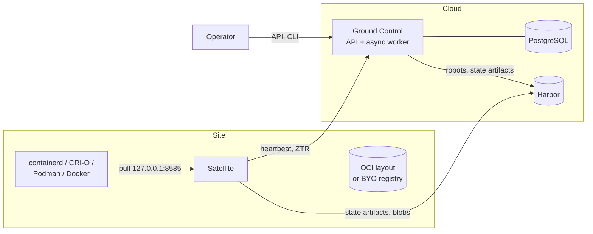

Harbor Satellite has three parts: Harbor as the source of truth for artifacts, Ground Control as the fleet manager, and a satellite at each site. Ground Control never carries artifact data. Satellites pull from Harbor directly with their own robot credentials.

## Desired State

An operator describes what each site should hold:

- A **group** is a list of artifacts (repository, tag, optional digest).
- A **config** is a satellite `app_config` document.
- A **satellite** has one config and any number of groups.

Ground Control renders each of them into an OCI artifact in Harbor's `satellite` project:

| Artifact | Content |
|---|---|
| `satellite/group-state/<group>/state` | The group's artifacts. |
| `satellite/config-state/<config>/state` | The config document. |
| `satellite/satellite-state/<satellite>/state` | References to the satellite's group states and its config state. Published also when the satellite has no groups, so leaving the last group stops its replication. |

Each satellite has a Harbor robot account that can pull the projects of all its groups plus `satellite`.

## Ground Control: Synchronous Core and Async Plane

An admin request is one PostgreSQL transaction. It changes the fleet tables and appends an event to `event_outbox` in the same commit. It does not call Harbor, so a write succeeds or fails as a whole, and Ground Control accepts writes while Harbor is down. Token registration and credential refresh are the exceptions: they must return a robot secret, so they rotate it in Harbor during the request.

The async worker publishes the outbox:

1. It claims due events with `FOR UPDATE SKIP LOCKED` under a lease, so any number of workers share the queue.
2. Around each event it holds an advisory lock on the event's aggregate, so one satellite, group or config is reconciled by one worker at a time.
3. Reconcilers are level triggered. They ignore the event's content, render the aggregate from the current tables, and push to Harbor only when the rendered digest differs from the one recorded as published in `desired_state`. Duplicate, reordered and replayed events therefore converge, and an unchanged aggregate costs no Harbor call.
4. A failure is retried with exponential backoff. A Harbor outage costs no attempts: while the Harbor probe sees no contact for three intervals the publisher claims nothing, and events that ran out of attempts are re-armed when Harbor is back.
5. A group change publishes the group state and then queues one reconcile per member satellite, so a large group fans out without one long job.
6. A delete leaves a tombstone event. Its handler removes the robots, the state artifact and the SPIRE entries.

The worker also runs the periodic jobs: stale detection, session and login state expiry, daily `satellite_status` partitions, outbox retention, robot rotation and webhook delivery.

The worker runs inside `groundcontrol serve` by default (`--worker=embedded`) or as separate `groundcontrol worker` processes.

## Hot Path and Cold Path

The design keeps work that a request does not need off its path.

| Path | Ground Control | Satellite |
|---|---|---|
| Hot | Heartbeats: authenticated from a session cache, buffered per process and written in batches every `HEARTBEAT_FLUSH_INTERVAL`. Satellite routes use their own database pool. | Pulls through the loopback proxy: served from the local store under a shared index lock. With streaming pull-through, a miss is answered once the manifest is stored, and blobs stream while they are written. |
| Cold | The async worker: Harbor reconciliation, rotation, retention, webhooks. Its own pool, rate limited toward Harbor. | Replication, garbage collection and reporting: scheduled processes and a bounded background lane. Replication stages copies outside the layout and publishes a complete graph under the exclusive index lock. Garbage collection deletes unreferenced content only after `STORE_GC_GRACE` and never while a reader holds it. |

Ground Control opens one connection pool per plane, API, fleet and async, each with its own limits, timeouts and `application_name`, so a busy fleet cannot starve admin requests and the reverse.

## Satellite Lifecycle

| State | Meaning |
|---|---|
| `pending` | Registered, no heartbeat yet, or unrevoked. |
| `online` | Heartbeats arrive. |
| `stale` | No heartbeat for three heartbeat intervals (`STALE_THRESHOLD` when the interval is not `@every`). The next heartbeat makes it `online` again. |
| `revoked` | An operator revoked it. Its robot is disabled in Harbor, and sync and registration answer `403`. |

`satellite_view` is the read model behind the fleet listings. It holds the state, the last heartbeat, the state and config digests the satellite applied, and the digests Ground Control published, so `GET /api/satellites/{satellite}/lifecycle` reports whether a satellite has converged.

## Satellite

Each replication tick resolves the satellite state artifact and every group state with one `HEAD` and fetches only the ones whose digest changed. For each changed group it replicates first and deletes afterwards, so a re-tagged image never goes missing. A delete removes a tag only while it still points at the old digest. `replication_concurrency` bounds the groups replicating at once, and `replication_bandwidth_bytes_per_sec` caps replication downloads.

The local store is an OCI image layout managed with ORAS, or a BYO registry. Writes to `index.json` are atomic. An unreadable index is quarantined at startup, and every group is replicated again.

With peer distribution enabled, replication tries other satellites' registries before Harbor, and continues from the last known state list while Harbor is unreachable.

The proxy on `127.0.0.1:<proxy-port>` serves pulls from the store. Its handler chain rejects clients that are not on loopback, then runs edge admission (a Casbin bundle delivered in the config), then the pull handler.

## Edge Journal

The satellite records every replicated or deleted artifact, CRI result and pull-through fill in a durable journal under `<config-dir>/journal`. Writes are group committed, and a full journal drops records and counts them instead of blocking replication. Heartbeats upload journal batches, and Ground Control's acknowledgement lets the satellite delete them.

Ground Control does not ingest the journal in this release. See [Known Limitations](/docs/changelog/#known-limitations).

## Identity

| Who | To | Credential |
|---|---|---|
| Satellite | Ground Control, registration | One-time token, or an X.509 SVID over mTLS. |
| Satellite | Ground Control, after registration | Satellite session token (`hss_...`, stored as SHA-256), or the SVID. Robot Basic auth is still accepted while `SATELLITE_ROBOT_AUTH=true`. |
| Satellite | Harbor | Per-satellite robot account, rotated before expiry when `ROBOT_ROTATION_ENABLED=true`. |
| Operator | Ground Control | Password session or OIDC session. Basic auth also works. |
| Ground Control | Harbor | `HARBOR_USERNAME` and `HARBOR_PASSWORD`. |

Authorization of operators is the built-in role check or a Casbin policy (`POLICY_ENGINE=casbin`). See [Security Model](/docs/concepts/security/).

## Extension Points

- **Webhooks.** Every outbox event can be delivered to HTTPS receivers as a signed CloudEvent, at least once and in order per subscription.
- **Event catalog.** One JSON Schema per event kind in `spec/events/v1`.
- **Proxy middleware.** The satellite's proxy chain has slots for metrics, authentication and admission.
- **Registry events.** Ground Control can let groups follow pushed tags through a registry event source. Harbor has no such feed yet, so nothing is wired. See [Ground Control as a Harbor 3 Extension](/docs/guides/harbor3-extension/).

Design records: [ADR-0013](/docs/decisions/0013-edge-store-concurrency-and-pull-through-streaming/) to [ADR-0020](/docs/decisions/0020-postgresql-19-minimum/).
